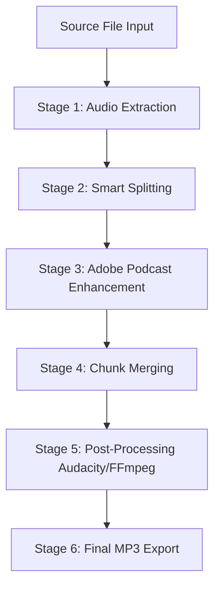

# Audio Enhancement Suite: End-to-End Pipeline & Trouble-Shooting Guide

This document provides a comprehensive breakdown of the entire pipeline, from the moment a source file is loaded to the final MP3 export. It details how each stage works under the hood, the failure points we resolved, and the exact solutions implemented to make the suite robust and reliable.

---

## 1. Complete Pipeline Architecture (Stage-by-Stage)

Below is the chronological sequence of the automation suite:



---

## 2. Stage-by-Stage Breakdown: Mechanics, Failures & Solutions

### Stage 1: Audio Extraction
* **What it does:** Extracts or converts the source video/audio file into a standardized **48kHz, stereo, 16-bit PCM WAV** file (`audio_master.wav`) using FFmpeg.
* **Why this is done:** Adobe Podcast and Audacity require consistent sample rates and formats. Converting everything to uncompressed WAV upfront avoids sample rate mismatches.
* **Potential Errors:** 
  * *FFmpeg not found* (leads to immediate crash).
  * *Corrupt source container* (leads to FFmpeg write errors).
* **Solutions implemented:** 
  * Automated FFmpeg search paths on Windows (`C:\ffmpeg\bin`, etc.) in case the environment PATH is not set.
  * Validation checks to ensure the extracted `audio_master.wav` exists and is readable before proceeding.

---

### Stage 2: Smart Splitting
* **What it does:** Splits the master WAV file into chunks of **less than 29 minutes** (to satisfy Adobe Podcast's file size/duration limits).
* **Smart Logic:** Instead of blind splitting (which can cut off speech mid-word), the system runs an FFmpeg `silencedetect` pass. It scans a 60-second window around the ideal boundary, finds the quietest midpoint, and splits there.
* **Potential Errors:**
  * *Boundary audio distortion* or *chopped sentences* when split blindly.
  * *Large file rejection* from Adobe Podcast if splits exceed 30 minutes.
* **Solutions implemented:** 
  * Implemented snap-to-silence window of 60 seconds.
  * Automated fallback to hard splits if no silence is detected.

---

### Stage 3: Adobe Podcast Enhancement (Upload & Download)
* **What it does:** Uploads chunks concurrently to Adobe Podcast using Selenium-controlled Chrome profiles.
* **Mechanics:**
  1. Assigns chunks to profiles based on remaining daily quota.
  2. Launches Chrome, navigates to Adobe Podcast, and drags-and-drops the file.
  3. Polls the page for processing status.
  4. Downloads the enhanced file and saves it in `enhanced/`.
* **Vulnerabilities & Failures:**
  * **Pop-up dialogs:** Adobe frequently displays promotional pop-ups, tutorial overlays, or feedback prompts. These block element clicks.
  * **Download button hangups:** The "Download" button was slow to appear, and clicking it via Selenium sometimes failed due to layout shifts.
  * **Unknown state timeouts:** Selenium failed to read elements if the page modified its selectors.
* **Solutions implemented:**
  * **Auto-Dismiss Modals:** Added an automatic clicker that targets modal overlays and background panels to click away pop-ups as soon as they appear.
  * **Chrome DevTools (CDP) Network Sniffing:** We configured Chrome to intercept network requests. When Adobe Podcasting finishes processing, its server sends a JSON response containing the **direct signed Amazon S3 URL** of the `.wav` download. The python script sniffs this URL and downloads the file directly using Python's `requests` library. This bypasses the browser's download UI entirely.
  * **Continuous Polling:** Replaced fragile timeouts with continuous element state scanners.

---

### Stage 4: Chunk Merging
* **What it does:** Concatenates all enhanced WAV chunks in order into a single `merged_enhanced.wav` using FFmpeg's `concat` demuxer.
* **Why we do it here:** In previous versions, post-processing (compression, EQ, limiting) was applied to chunks *individually* before merging. This caused severe boundary artifacts (clicks, volume bumps, and mismatched levels at transitions). Normalizing and compressing the file as a single merged entity maintains consistent audio characteristics across the entire timeline.
* **Potential Errors:**
  * *Mismatch in audio parameters* if chunks have different channel layouts.
* **Solutions implemented:**
  * Ensured every chunk is standardized to 48kHz stereo before upload, so the FFmpeg concat demuxer can combine them without re-encoding.

---

### Stage 5: Post-Processing (Audacity Macro / FFmpeg)
* **What it does:** Applies the custom voice macro (`Compressor -> EQ Curve -> Pitch Shift -> Limiter -> Normalize`) to the merged audio.
* **Modes:**
  * **Audacity Macro Mode:** Automates the desktop Audacity app via named pipes.
  * **FFmpeg Mode:** A mathematical replica of the Audacity filters computed directly via FFmpeg filters.
* **Vulnerabilities & Failures:**
  * **Named Pipe Crash (`[Errno 22]`):** The connection script ran a test open/close check which terminated the named pipe server inside Audacity, causing subsequent commands to fail.
  * **Audacity Launch Timeout:** The script failed if it did not wait long enough for Audacity to load.
  * **Buffer Desynchronization (Silent Failures):** In Audacity's script pipe, responses start with a leading newline (`\n`) for commands that return output data. The old read loop in Python checked `if line == '\n' or not line: break`. This caused Python to exit the read loop immediately on the first line (the `\n`), returning `""` and leaving the actual response queued in the pipe buffer. This desynchronized the buffer queue, causing subsequent commands to read the responses of the previous commands, leading to silent failures where tracks were not imported/exported, causing the subsequent MP3 step to crash due to a missing `merged.wav` input file.
  * **Modal Dialog Blockages (Indefinite Hangs):** If Audacity is launched and displays a modal startup window (like the **Crash Recovery** dialog after a previous crash/force-close, or the **Welcome to Audacity** prompt), it enters a modal event loop and **blocks named pipe processing**. This leaves the script hanging indefinitely on the first command.
* **Solutions implemented:**
  * **Direct Pipe Session Persistence:** Changed the connection flow in [audacity_engine.py](file:///A:/Automation%20Workflows/AudioEnhancementSuite/core/audacity_engine.py#L103-L133) to open the pipes exactly once. Handles are kept alive for the duration of the track operations and closed safely only at the end.
  * **Startup Grace Period:** The script will actively wait up to 25 seconds for Audacity to load, testing the connection on each loop iteration without closing it.
  * **PowerShell cleanup:** Terminated stuck `Audacity.exe` background processes to reset the Named Pipe server state.
  * **Synchronized Response Parser:** Rewrote the pipe reader to continuously read lines until it finds the `BatchCommand finished:` line, and then read the trailing empty newline. This ensures the pipe buffer is fully cleared and synchronized for every command, and real errors are detected immediately.
  * **Threaded Read Timeout Protection:** Wrapped named pipe reading inside a background thread with a 120-second timeout (`join(timeout=120.0)`). If Audacity hangs on a modal dialog (such as Crash Recovery), the script raises a descriptive `TimeoutError` instructing the user to dismiss the dialog in the GUI, avoiding infinite hangs.

---

## 3. The Stateful Named Pipe Solution: Under the Hood

### The Problem
Traditional file or network logic in Python:
`Check state -> Close -> Re-open` works fine because files and HTTP ports are stateless or designed to accept multiple connections.

Windows Named Pipes in Audacity's `mod-script-pipe`:
1. Audacity boots and exposes `\\.\pipe\ToSrvPipe`.
2. Python connects to the pipe to check if it's there.
3. Python closes the connection.
4. Audacity's script DLL reads the close signal, treats it as "client has finished using my services," exits the listening thread, and **destroys the pipe**.
5. The pipe disappears from the system. Future attempts to connect fail.

### The Fix
We eliminated the connection test block. The connection is established directly inside the active `AudacitySession` wrapper:
```python
# Create the session wrapper
session = AudacitySession()
# Attempt to open both pipes. If FileNotFoundError, sleep and retry.
# Do NOT close them until the entire macro execution is finished.
session.connect() 
```
This preserves the pipe's integrity and guarantees the scripting engine remains listening until the final export is written.

---

## 4. Troubleshooting & Pipeline Recovery Guide

If the pipeline gets interrupted, use the following steps to recover without losing progress:

### How to Resume starting from any stage:
1. **Open the Suite UI.**
2. Set the **Post-Processing Mode** in the sidebar (Audacity Macro Mode or FFmpeg replica).
3. Set the **Starting Stage** in the sidebar:
   * **Post Processing:** Select this if you have already enhanced and merged the audio and just want to run/re-run the Audacity Macro.
   * **Merging:** Select this if chunks are downloaded but not merged yet.
   * **Adobe Enhancement:** Select this if some chunks failed to upload or download.
   * **Exporting:** Select this to re-run the final MP3 conversion.
4. Go to **Tools ➔ Resume Incomplete Project...**, choose your active project folder (`YouCut_20260531_205153942_20260601_135414`), and click **Resume**.
5. The suite will read [pipeline_state.json](file:///A:/Automation%20Workflows/AudioEnhancementSuite/projects/YouCut_20260531_205153942_20260601_135414/pipeline_state.json), delete any intermediate output files that need to be re-created, and start executing from your selected stage.

---

## 5. Performance Optimizations & Auto-Deployment

### 🎛️ Mono WAV Downmixing (Speed Up: 2x)
* **What changed:** Standard voice recordings are single-channel (mono) sources. Previously, the pipeline extracted audio as stereo (`-ac 2`), writing duplicate audio tracks, resulting in **400+ MB** WAV files. We updated the extraction, smart-splitting, and post-processing filters to use mono (`-ac 1`).
* **Benefits:** 
  * Intermediate WAV size is cut exactly in half (**~213 MB** instead of 427 MB).
  * Uploads to Adobe Podcast, downloads, splits, and Audacity filters are **2x faster**.
  * Final MP3 exports upmix the mono back to stereo (`-ac 2`) to ensure universal media player compatibility.

### 📦 Auto-FFmpeg Installer
* **How it works:** If FFmpeg is missing on the host machine, instead of crashing, `locate_ffmpeg` triggers `download_ffmpeg`. This fetches the official static build from GitHub, extracts `ffmpeg.exe` and `ffprobe.exe` to a local `ffmpeg/` folder inside the app directory, and logs progress percentage updates to the GUI log panel.

### 🖥️ Standalone App Compilation (Nuitka / PyInstaller)
* **Nuitka Crash:** We attempted to compile the GUI using Nuitka. However, Nuitka crashed during parsing due to a known optimization bug (`AssertionError: listcomp_1__.0_clone`) related to list comprehension structures.
* **Defender Blocks on `--onefile`:** PyInstaller `--onefile` packaging formats are self-extracting zip executables, which are frequently quarantined/blocked by Windows Defender heuristics.
* **The Solution:** We compiled the app as a standalone, single-directory build (`--onedir`) using the PyQt6 plugin and explicit PyQt5 module exclusions (`--exclude-module PyQt5 --exclude-module PyQt5.sip`) to resolve internal Qt environment conflicts.
  * **Build Directory:** [dist/AudioEnhancementSuite/](file:///A:/Automation%20Workflows/AudioEnhancementSuite/dist/AudioEnhancementSuite/)
  * **Executable:** [AudioEnhancementSuite.exe](file:///A:/Automation%20Workflows/AudioEnhancementSuite/dist/AudioEnhancementSuite/AudioEnhancementSuite.exe)
  * **Desktop Shortcut:** A shortcut featuring a custom gold-gradient audio wave icon is located at `C:\Users\Muhammad Ayyan\Desktop\Audio Enhancement Suite.lnk`. It launches the app window with the console hidden.
